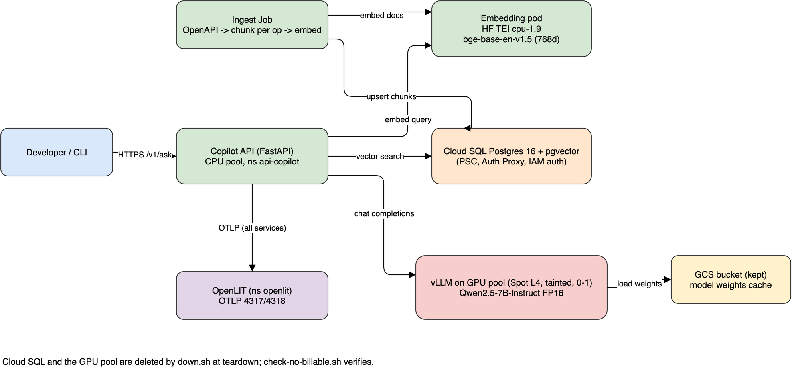

# Design: grounded API documentation copilot

Status: design stage, Increment 1 (grounded answers only; no request execution).
Items marked **UNVERIFIED** come from memory and must be re-checked before relying on them (see Open items).

## 1. Goals and non-goals

Goals
- Answer questions about OpenAPI specs; every answer carries citations: operation ID, path (and method), spec version.
- Refuse or say "not found in the indexed specs" when retrieval finds nothing relevant (grounded, not free-form).
- Run as a workload on the ephemeral GKE cluster from `miqui/gke-ai-observer`, deployed by Argo CD from git, constrained by Kyverno, observed through OpenLIT (OTLP).
- Self-hosted models only (embedding + LLM); no external LLM API.
- Zero billable leftovers after a session (section 8).

Non-goals (Increment 1)
- Executing API requests, auth flows, or "try it" features.
- Multi-tenant auth, rate limiting, UI.
- Changing `gke-deploy.sh` or the cluster creation path.
- Production HA. The cluster is ephemeral.

## 2. Architecture



Source: `architecture.drawio` (regenerable via `docs/gen_arch.py`).

Flow
1. Ingest Job: OpenAPI specs -> one chunk per operation -> TEI embeddings -> pgvector rows.
2. Query: CLI -> Copilot API -> embed query (TEI) -> top-k search (pgvector) -> prompt with retrieved operations -> vLLM -> answer + citations taken from retrieved rows (never from model-invented IDs; the API validates that cited operation IDs were in the retrieved set).
3. All services export OTLP (4317 gRPC / 4318 HTTP) to OpenLIT in namespace `openlit`.

## 3. Component specs

| Component | Where | Spec |
|---|---|---|
| Copilot API | CPU pool, ns `api-copilot` | FastAPI; Cloud SQL Auth Proxy sidecar; talks to TEI, vLLM via in-cluster Services. `VectorStore` interface (`upsert`, `search`) with a pgvector implementation, so the DB is swappable. |
| Embedding | CPU pool | `ghcr.io/huggingface/text-embeddings-inference:cpu-1.9`, model `BAAI/bge-base-en-v1.5` (MIT, 768-dim). Queries need prefix `Represent this sentence for searching relevant passages: `; documents do not. |
| Vector DB | Cloud SQL | Postgres 16 Enterprise, `db-custom-1-3840`, pgvector, `vector(768)` + HNSW. Reached over Private Service Connect through `gcr.io/cloud-sql-connectors/cloud-sql-proxy` sidecar. IAM database auth via Workload Identity; no passwords. |
| LLM | dedicated GPU pool | Spot L4 `g2-standard-4`, tainted, autoscale 0-1, own 100-200 GB boot disk. `vllm/vllm-openai:v0.32.0-cu129`, model `Qwen/Qwen2.5-7B-Instruct` (Apache-2.0, ungated), flags `--dtype float16 --max-model-len 16384 --gpu-memory-utilization 0.90 --max-num-seqs 16`. Weights cached in a kept GCS bucket to avoid a ~15 GB re-download per session. |
| Ingest Job | CPU pool | K8s Job; same VectorStore + TEI client code as the API. |
| Local test stub | kind | CPU stub serving the same OpenAI-compatible API as vLLM; no GPU needed. GPU path is dry-run validated only until quota exists. |

## 4. Data model (pgvector)

```sql
CREATE EXTENSION IF NOT EXISTS vector;

CREATE TABLE spec (
  spec_id      text PRIMARY KEY,           -- e.g. "petstore"
  title        text NOT NULL,
  spec_version text NOT NULL,              -- info.version of the spec
  openapi      text NOT NULL,              -- "3.0.3", "3.1.0"
  source_sha256 text NOT NULL,
  ingested_at  timestamptz NOT NULL DEFAULT now()
);

CREATE TABLE operation_chunk (
  id           bigserial PRIMARY KEY,
  spec_id      text NOT NULL REFERENCES spec ON DELETE CASCADE,
  operation_id text NOT NULL,              -- synthesized from method+path if absent
  method       text NOT NULL,
  path         text NOT NULL,
  content      text NOT NULL,              -- rendered operation text that was embedded
  embedding    vector(768) NOT NULL,
  UNIQUE (spec_id, method, path)
);
CREATE INDEX operation_chunk_hnsw ON operation_chunk
  USING hnsw (embedding vector_cosine_ops);
```

The 768 dimension is confirmed only after reading the model's `config.json` (open item).

## 5. API contract sketch

`POST /v1/ask` body `{"question": str, "spec_id": str|null, "top_k": int=5}`

```json
{
  "answer": "string",
  "grounded": true,
  "citations": [
    {"spec_id": "petstore", "spec_version": "1.0.7", "operation_id": "getPetById",
     "method": "GET", "path": "/pet/{petId}"}
  ]
}
```
`grounded=false` with empty citations when retrieval is below a similarity threshold. Also `GET /healthz`, `GET /readyz`. Final schema will be an OpenAPI doc in the implementation PR.

## 6. Security model

- No passwords or keys in git or images. Cloud SQL via IAM database auth + Workload Identity (GSA bound to the KSA).
- Cloud SQL private only (PSC); no public IP.
- Pods: non-root, no privilege escalation, drop ALL caps, RuntimeDefault seccomp, no host namespaces/hostPath, pinned image tags (Kyverno-enforced).
- NetworkPolicy default deny ingress; scoped egress (section 9).
- Retrieved spec text is untrusted input to the LLM: the answer path only cites IDs from the retrieved set; no tool/exec capability in Increment 1.
- Secret scanning: `betterleaks dir .` locally before every push (see `ci-design.md`).

## 7. Observability

Each service exports OTLP traces/metrics to OpenLIT (`openlit` ns, 4317/4318). vLLM and TEI expose Prometheus metrics; wiring to OpenLIT is an implementation-stage item.

## 8. TEARDOWN CONSTRAINT (non-negotiable)

**`gke-teardown.sh` must delete everything on GCP that costs money, and must never hang or fail silently.**

Sibling-repo scripts (in `scripts/`, implemented later):
- `add-gpu-pool.sh`: adds the tainted Spot L4 pool.
- `cloudsql-up.sh`: enables `sqladmin` / `servicenetworking` APIs itself; creates a per-session **uniquely named** Cloud SQL instance (deleted names are unusable for about a week); creates the PSC endpoint address + forwarding rule.
- `down.sh`: bounded timeouts; deletes GPU pool, then Cloud SQL (after `--no-deletion-protection`), then PSC forwarding rule, then its address; checks every delete.
- `check-no-billable.sh` (read-only): lists clusters, node-pools, instances, instance-groups/templates, disks, snapshots, images, forwarding-rules, target proxies / backend-services / url-maps / health-checks, addresses, routers + NATs, service-attachments, NEGs, firewall rules `gke-*`, networks/subnets, VPC peerings, SQL instances, buckets (allowlist: the kept model-weights bucket), artifact repos, secrets. Anything non-empty outside the allowlist exits non-zero. **A failed gcloud call is a FAILURE, not "empty".**

Deletion order: `down.sh` -> in-cluster Services/PVCs -> GPU pool -> Cloud SQL -> PSC rule then address -> existing steps (cluster, NEGs, disks, firewall, NAT, router, subnet, VPC). Buckets/secrets/SAs stay unless `--purge`, as today.

A separate later PR to `gke-ai-observer` adds a hook in `gke-teardown.sh` calling `down.sh` first with a timeout, hardens existing silent-failure paths (deletes without `--timeout`, `|| true` on listings, a 20-minute wait loop that falls through, `--purge` swallowing errors, unconditional "Teardown complete"), and ends with the verification that exits non-zero. `gke-deploy.sh` is never changed. No GCP deploys by anyone but Miguel.

## 9. Platform integration (later PR to `gke-ai-observer`)

- `k8s/policies/rules/restrict-image-repositories.yaml`: add `docker.io/vllm/vllm-openai`, `gcr.io/cloud-sql-connectors/cloud-sql-proxy`, `ghcr.io/huggingface/text-embeddings-inference`, and the copilot image repo.
- Add `api-copilot` to the audit-other overlay `namespaceSelector` AND to the separate hard-coded namespace list in `audit-only/disallow-latest-tag.yaml`.
- Set `WORKLOAD_DIRS` in `check-policies.sh` (needs kyverno CLI: local 1.19.2, CI pins 1.19.1; and kubectl).
- New Argo Application `k8s/argocd/apps/api-copilot.yaml`: sync-wave 1, plain-manifests path, `targetRevision: main`, automated prune + selfHeal.
- ResourceQuota including `requests.nvidia.com/gpu: "1"`.
- NetworkPolicies: default-deny-ingress, allow-same-namespace; egress: DNS to kube-dns, OTLP to ns `openlit` 4317/4318, Cloud SQL PSC IP `/32` TCP 3307, metadata server `169.254.169.254` TCP 80/988, HTTPS 443 for weights/HF scoped by pod label.
- Kyverno pod demands: CPU/mem requests+limits on every container incl. sidecars; `runAsNonRoot: true`; `allowPrivilegeEscalation: false` explicit at container level; capabilities drop ALL; seccomp RuntimeDefault; no host namespaces/hostPath; pinned tags. vLLM needs a non-root user plus emptyDir for `HF_HOME`, `/tmp`, caches and `/dev/shm` (emptyDir `medium: Memory`). Kyverno rules do not autogen for Jobs, so the ingest Job pod spec must satisfy them directly.

## 10. Cost (UNVERIFIED estimate)

About $0.65-0.80/hr, $2.60-3.20 per 4 h session, including a one-off ~$0.72 NAT charge for the weights download. From memory; re-check against GCP pricing pages.

## 11. Risks

- No GPU quota yet: the GPU path is unproven end to end.
- Spot L4 preemption or capacity stock-outs mid-session.
- Teardown drift leaving billable resources (mitigated by `check-no-billable.sh`).
- Cloud SQL name reuse lockout (unique per-session names).
- vLLM image may assume root / specific CUDA arch (see open items).
- 7B model may follow citation instructions imperfectly; mitigated by server-side citation validation.

## 12. Open items (unverified)

- vLLM `v0.32.0-cu129` running as non-root with Kyverno constraints, and support for L4 (sm_89) at that tag: UNVERIFIED.
- Cost figures: UNVERIFIED.
- bge-base-en-v1.5 dimension 768: confirm from `config.json`.
- Exact TEI `cpu-1.9` and vLLM tags exist on their registries: confirm at implementation.
- Chunking details (parameters, `$ref` resolution, operations without `operationId`).
- Similarity threshold for `grounded=false`.
